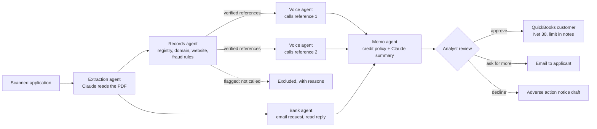

# Vouch

Vouch is an AI credit desk for B2B net terms. A customer sends in a credit application, and Vouch reads it, checks the business and its references against public records, phones each trade reference, emails the bank, and hands a credit analyst a finished memo with a recommended limit. The analyst approves in one click and the customer is created in QuickBooks.

Built by team AwesomeSauce for the BBS × Ramp Hackathon (Fall 2026).


## The problem

When a new business customer asks to pay on Net 30, someone on the seller's finance team still vets them by hand. The customer fills out a PDF application that lists a bank and three trade references. An analyst retypes it, emails the bank, and calls each reference to ask how much credit they extend and whether the customer pays on time. References are slow to answer because helping another supplier's credit team is nobody's priority, so one approval can take days of phone tag while sales waits.

It is also where fraud gets in. Applicants choose their own references, and a busy analyst rarely checks whether "Bayview Packaging" was registered last month at the applicant's own address.

Ramp's Accounts Receivable product (launched September 2026) automates invoice to cash, but it starts after a customer has been approved. Vouch is the step in front of it.

## What it does



| Agent | Job | Claude's role | Deterministic part |
|---|---|---|---|
| Extraction | Scanned PDF or photo to structured application | Reads the document natively (vision), output forced through a typed tool schema | Pydantic validation, phone/email normalization |
| Records | Is the business real? Are the references independent? | none | Registry lookup, domain age (RDAP), phone numbers on the company website, 10 fraud rules |
| Voice | Calls each verified reference and interviews them | Live conversation (Haiku, streamed), live note-taking, final transcript read (Sonnet) | Call retries, voicemail and callback handling |
| Bank | Requests a bank reference by email | Reads the bank's free-text reply | Request letter template, wait with timeout |
| Memo | Recommends a decision and limit | Writes the summary, citing evidence IDs | Credit policy (YAML) computes the decision and every number |


## Design decisions

**Claude talks and reads; policy decides.** Every number in a recommendation comes from `backend/vouch/policy/credit_policy.yaml` applied in plain Python (`agents/decision.py`). Claude writes the explanation, and each sentence must cite evidence IDs that exist; unknown citations are dropped. Credit decisions need reasons you can repeat to an applicant and to a regulator, so a model never decides what is flagged or how much credit to extend.

**Fraud checks are rules, not vibes.** `agents/verification.py` flags a reference if it shares the applicant's phone number, address, or officers, was registered recently, has a brand-new website domain, uses a free email address, or lists a phone that is not on its own website. Flagged references are not called, which also saves the time of the calls.

**One conversation engine, three phone lines.** The voice agent speaks the Twilio ConversationRelay WebSocket protocol: Twilio does speech recognition and synthesis, Vouch receives the reference's words as `prompt` messages and streams its reply back as `text` tokens. The in-app browser phone and the simulated reference speak the same protocol, so the agent code is identical for a real call, a teammate answering in a browser tab, or an unattended demo.

**Durable workflow, built for waiting.** Reference checks wait on people: a reference does not pick up, asks for a callback Thursday, or the bank takes a day to reply. `engine.py` stores every step in SQLite with its state, scheduled retry time, and wait timeout. If the server restarts mid-application, waiting steps keep waiting, retries keep their times, and calls that were cut off are retried. There is a test that kills the engine mid-flight and resumes in a new process.

**The AI says it is an AI.** Every call opens with "Hi, this is Vouch, an AI assistant calling on behalf of Northline Supply's credit team, on a recorded line," and the agent never discloses the applicant's requested amount.

**Every claim is traceable.** Memo bullets link to the call transcript, the bank's email, or the registry record they came from.

**Honest about the limits of each integration.** QuickBooks Online's API cannot read or write a customer's credit limit, so Vouch sets the payment terms and records the approved limit and memo link in the customer's notes. The demo companies are fictional, so their registry, domain, and website records come from a labeled sandbox file; real companies go to OpenCorporates and live RDAP lookups.

## Run it

Requirements: Python 3.10+, Node 18+. macOS: `brew install python@3.12 node`.

```bash
make setup        # backend virtualenv, frontend packages, .env
# add ANTHROPIC_API_KEY to .env
make dev          # http://localhost:5173
```

Click **New application**, then run the **Acme Bakery Supply** sample. In a minute or two Vouch reads the scan, flags Bayview Packaging (registered 23 days ago, on the applicant's own phone line and address, sharing the applicant's owner as an officer), calls Harbor Paper (no answer, then a retry that connects) and Coastal Flour Mills, gets the bank's reply, and recommends $25,000 on Net 30 against the $30,000 requested. Approve it and the customer is written to the ledger (or QuickBooks).

Without an API key, Vouch runs in offline mode: scripted responses that work only with the two bundled samples. This is also how the test suite runs.

### Reference calls

Set `CALL_CHANNEL` in `.env`, or switch per application on the review screen.

- `simulated` (default): Claude plays each reference from a persona in `backend/vouch/fixtures/personas.json`, including one who asks for a callback and one who only gives written references.
- `browser`: open **Phone** in a second window. When Vouch calls, answer and talk (Chrome speech recognition) or type.
- `twilio`: real phone calls.
  1. Add `TWILIO_ACCOUNT_SID`, `TWILIO_AUTH_TOKEN`, `TWILIO_FROM_NUMBER` to `.env`.
  2. `make start` (single server on :8000) and, in another terminal, `make tunnel`.
  3. Put the tunnel's https URL in `PUBLIC_BASE_URL` and restart.
  4. For a live demo, set `DEMO_REFERENCE_PHONE` to a teammate's phone so every reference call rings it, while the memo still shows the number from the application.

### Security note

Vouch has no login. Run it on your own machine, or put it behind your own auth before exposing it. Twilio webhooks are verified with Twilio's request signature.

### QuickBooks sandbox

Create an app at developer.intuit.com, add `http://localhost:8000/api/integrations/quickbooks/callback` (or your tunnel URL) as a redirect URI, set `ACCOUNTING_MODE=quickbooks` with the client ID and secret, then **Settings → Connect QuickBooks**.

## Tests

```bash
make test
```

The backend suite (41 tests, about 15 seconds, no API key) covers the workflow engine (waits, signals, retries, timeouts, restart recovery), the fraud rules and credit policy math, full application runs for both samples, the REST API, the browser phone and Twilio ConversationRelay protocols over real WebSockets, Twilio webhook signature checks, TwiML generation, and how the Claude client handles the 5.5 models' tool-choice rules.

`make smoke` is the live check: with your API key it has Claude read both sample scans and compares every field with the answer key, then runs one application end to end.

## Project layout

```
backend/vouch/
  engine.py            durable step engine (SQLite)
  workflow.py          the credit check graph and its step handlers
  calls.py             call placement, ConversationRelay session, simulated reference
  agents/              extraction, verification, voice, bank, decision
  providers/           registry/domain/website lookups, Twilio, email, QuickBooks/ledger
  policy/credit_policy.yaml
  fixtures/            sample answer keys, sandbox records, reference personas
  api/                 REST, Server-Sent Events, WebSockets, Twilio webhooks
frontend/src/          React review app, browser phone, settings
samples/               scanned sample applications and their generator
docs/                  architecture notes and demo script
```

## What's next

- **Ramp network data.** Ramp already sees how fast its customers pay their own vendors. With the applicant's consent, that payment history could answer a reference check in seconds, and would replace self-selected references with real data.
- Ongoing monitoring: re-check approved customers when a reference reports slow payment.
- Email-only references: send and read written reference forms for companies that will not answer by phone.
- Multi-entity applicants and personal guarantees.
