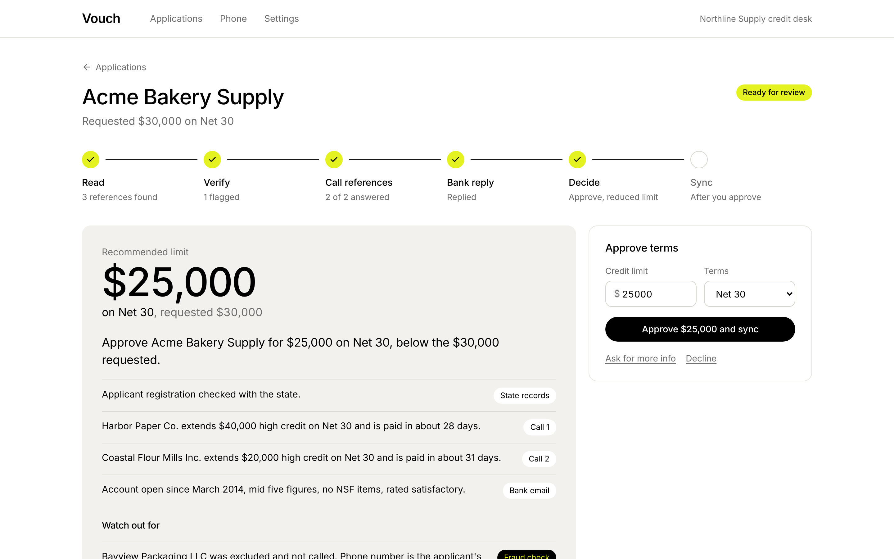
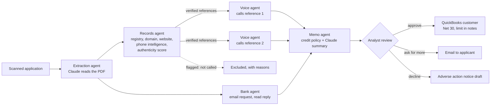
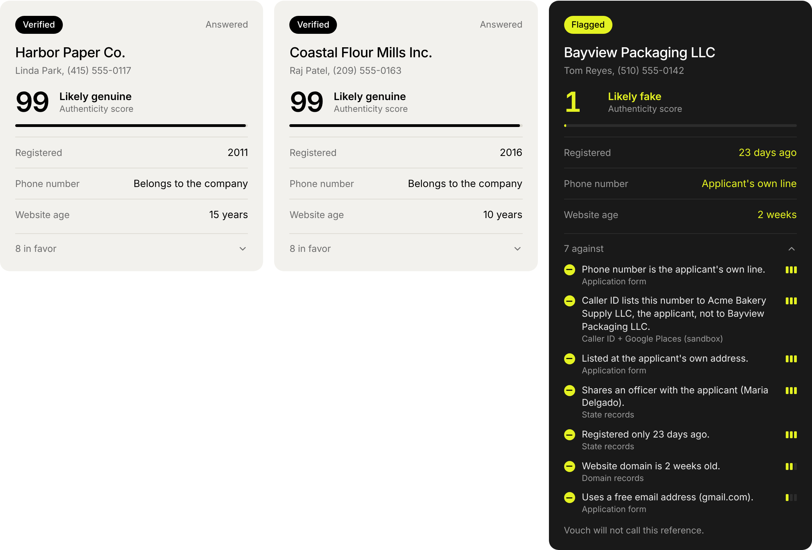
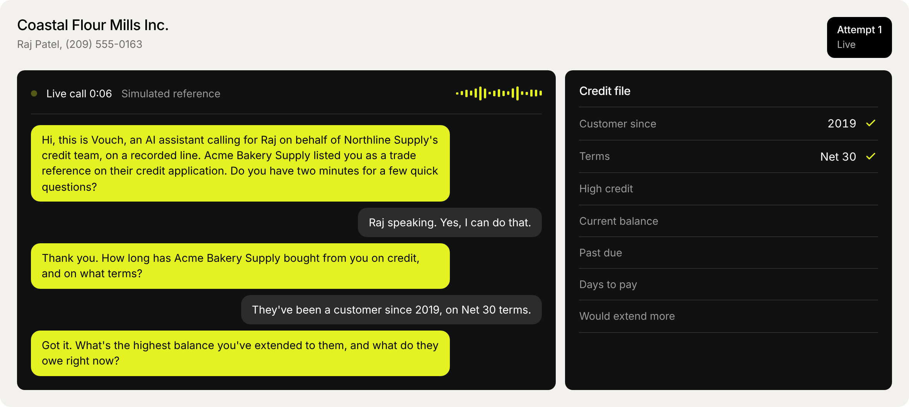

# Vouch

Vouch is an AI credit desk for B2B net terms. A customer sends in a credit application, and Vouch reads it, checks the business and its references against public records, phones each trade reference, emails the bank, and hands a credit analyst a finished memo with a recommended limit. The analyst approves in one click and the customer is created in QuickBooks.

Built by team AwesomeSauce for the BBS × Ramp Hackathon (Fall 2026).



## The problem

When a new business customer asks to pay on Net 30, someone on the seller's finance team still vets them by hand. The customer fills out a PDF application that lists a bank and three trade references. An analyst retypes it, emails the bank, and calls each reference to ask how much credit they extend and whether the customer pays on time. References are slow to answer because helping another supplier's credit team is nobody's priority, so one approval can take days of phone tag while sales waits.

It is also where fraud gets in. Applicants choose their own references, and a busy analyst rarely checks whether "Bayview Packaging" was registered last month at the applicant's own address.

Ramp's Accounts Receivable product (launched September 2026) automates invoice to cash, but it starts after a customer has been approved. Vouch is the step in front of it.

## What it does



| Agent | Job | Claude's role | Deterministic part |
|---|---|---|---|
| Extraction | Scanned PDF or photo to structured application | Reads the document natively (vision), output forced through a typed tool schema | Pydantic validation, phone/email normalization |
| Records | Is the business real? Are the references independent? | none | Registry lookup, domain age (RDAP), website phone numbers, phone intelligence (IPQualityScore, Twilio Lookup, Google Places), Vouch's history of numbers, and a 1 to 99 authenticity score per reference |
| Voice | Calls each verified reference and interviews them | Live conversation (Haiku, streamed), live note-taking, final transcript read (Sonnet) | Call retries, voicemail and callback handling |
| Bank | Requests a bank reference by email | Reads the bank's free-text reply | Request letter template, wait with timeout |
| Memo | Recommends a decision and limit | Writes the summary, citing evidence IDs | Credit policy (YAML) computes the decision and every number |





## Design decisions

**Claude talks and reads; policy decides.** Every number in a recommendation comes from `backend/vouch/policy/credit_policy.yaml` applied in plain Python (`agents/decision.py`). Claude writes the explanation, and each sentence must cite evidence IDs that exist; unknown citations are dropped. Credit decisions need reasons you can repeat to an applicant and to a regulator, so a model never decides what is flagged or how much credit to extend.

**Every reference gets an authenticity score.** A fake trade reference is usually a phone number the applicant controls: their own line, a friend's cell, or a Google Voice number made for the occasion. So Vouch checks who each reference's number really belongs to:

- **IPQualityScore**'s fraud model scores the number 0 to 100 and reports VoIP, recent abuse, and whether the line is active.
- **Twilio Lookup** returns the carrier's caller ID name and the line type (landline, mobile, business VoIP, or a virtual number anyone can create online).
- **Google Places** shows which business, if any, publicly lists the number.
- **Vouch's own history** catches a number that showed up for a different company on an earlier application, and credits one that answered a reference call before.

These join the record checks (state registration and officers, domain age, the company's website, shared phone or address with the applicant) in a logistic scorecard, the model family behind credit scores: each finding adds or subtracts log-odds and the total maps to a score from 1 to 99. The review screen shows every finding with its source and weight. A critical finding, like the number being listed to the applicant, flags the reference outright. Otherwise a score under 45 does. Flagged references are not called. The weights live in `credit_policy.yaml` next to the rest of the policy, set by hand for now; once there are enough decided applications they can be refit by logistic regression on the stored findings. A small company's reference number is often the owner's cell, so caller ID naming a person on the state record counts in the reference's favor, not against it.

**One conversation engine, three phone lines.** The voice agent speaks the Twilio ConversationRelay WebSocket protocol: Twilio does speech recognition and synthesis, Vouch receives the reference's words as `prompt` messages and streams its reply back as `text` tokens. The in-app browser phone and the simulated reference speak the same protocol, so the agent code is identical for a real call, a teammate answering in a browser tab, or an unattended demo.

**Follow-ups like an analyst would do them.** When a reference says "call me back tomorrow morning," the agent agrees, hangs up, and `followup.py` books the callback for 10 AM tomorrow in the reference's time zone (from the state on its address). It understands weekdays, "after 2," "this afternoon," and "in an hour"; anything vaguer goes to the next business morning. After two unanswered calls it also waits for the next business morning instead of redialing. When a machine answers, the agent recognizes the greeting ("Your call has been forwarded to an automated voice messaging system...") or Twilio's answering machine detection, stays quiet instead of starting the interview, and leaves a short message saying who called and that it will try again. The review screen shows when the next call is, and **Call now** pulls it forward.

**Durable workflow, built for waiting.** Reference checks wait on people: a reference does not pick up, asks for a callback Thursday, or the bank takes a day to reply. `engine.py` stores every step in SQLite with its state, scheduled retry time, and wait timeout. If the server restarts mid-application, waiting steps keep waiting, retries keep their times, and calls that were cut off are retried. There is a test that kills the engine mid-flight and resumes in a new process.

**The AI says it is an AI, and checks who it's talking to.** Every call opens with "Hi, this is Vouch, an AI assistant calling on behalf of Northline Supply's credit team, on a recorded line." Before any credit questions, the agent confirms the person handles the applicant's account, that the applicant buys from them on credit, and that they have the account details in front of them. The wrong person gets asked who handles it; a business that has never heard of the applicant ends the call, and that reference doesn't count. The agent never discloses the applicant's requested amount.

**Every claim is traceable.** Memo bullets link to the call transcript, the bank's email, or the registry record they came from.

**Honest about the limits of each integration.** QuickBooks Online's API cannot read or write a customer's credit limit, so Vouch sets the payment terms and records the approved limit and memo link in the customer's notes. The demo companies are fictional, so their registry, domain, website, and phone records come from a labeled sandbox file, and the review screen marks those findings "(sandbox)"; real companies go to OpenCorporates, live RDAP lookups, and the phone services above when their keys are set.

## Run it

Requirements: Python 3.10+, Node 18+. macOS: `brew install python@3.12 node`.

```bash
make setup        # backend virtualenv, frontend packages, .env
# add ANTHROPIC_API_KEY to .env
make dev          # http://localhost:5173
```

Click **New application**, then run the **Acme Bakery Supply** sample. In a minute or two Vouch reads the scan, flags Bayview Packaging (registered 23 days ago, on the applicant's own phone line and address, sharing the applicant's owner as an officer), calls Harbor Paper (voicemail, then a retry that connects) and Coastal Flour Mills (Raj asks for a callback tomorrow morning; click **Call now** on his panel to pull it forward), gets the bank's reply, and recommends $25,000 on Net 30 against the $30,000 requested. Approve it and the customer is written to the ledger (or QuickBooks).

For a recorded or live demo, set `PRESENTER_MODE=true`: Vouch pauses before checking references, before calling, and before emailing the bank, and a Next button (or the right arrow key) moves it on, so the app keeps pace with your narration.

Without an API key, Vouch runs in offline mode: scripted responses that work only with the two bundled samples. This is also how the test suite runs.

### Reference calls

Set `CALL_CHANNEL` in `.env`, or switch per application on the review screen. Each reference's call panel also has its own **Line** switch, and by default only the first reference uses a real line (`REAL_CALL_LIMIT=1`): the rest, including **Call now** on them, stay simulated, so a demo rings your phone once. Set `REAL_CALL_LIMIT=0` to call every reference for real.

- `simulated` (default): Claude plays each reference from a persona in `backend/vouch/fixtures/personas.json`, including one who asks for a callback and one who only gives written references.
- `browser`: open **Phone** in a second window. When Vouch calls, answer and talk (Chrome speech recognition) or type.
- `twilio`: real phone calls.
  1. In the Twilio Console, accept the AI/ML features addendum that ConversationRelay requires (Voice, Settings, Privacy & Security). A trial account can only call verified numbers and restricts custom TwiML, so upgrade the account and buy a voice number for a demo.
  2. Add `TWILIO_ACCOUNT_SID`, `TWILIO_AUTH_TOKEN`, `TWILIO_FROM_NUMBER` to `.env`.
  3. `make start` (single server on :8000, open http://localhost:8000) and, in another terminal, `brew install cloudflared` once, then `make tunnel`.
  4. Put the tunnel's https URL in `PUBLIC_BASE_URL` and restart `make start`. The quick tunnel URL changes every time the tunnel restarts.
  5. For a live demo, set `DEMO_REFERENCE_PHONE` to your own phone so every reference call rings it, while the memo still shows the number from the application. Calls to that phone go one at a time; the same goes for the browser phone.

### Security note

Vouch has no login. Run it on your own machine, or put it behind your own auth before exposing it. Twilio webhooks are verified with Twilio's request signature.

### QuickBooks sandbox

Create an app at developer.intuit.com, add `http://localhost:8000/api/integrations/quickbooks/callback` (or your tunnel URL) as a redirect URI, set `ACCOUNTING_MODE=quickbooks` with the client ID and secret, then **Settings → Connect QuickBooks**.

## Tests

```bash
make test
```

The backend suite (79 tests, about 25 seconds, no API key) covers the workflow engine (waits, signals, retries, timeouts, restart recovery), the fraud rules and credit policy math, full application runs for both samples, the REST API, the browser phone and Twilio ConversationRelay protocols over real WebSockets, Twilio webhook signature checks, TwiML generation, how the Claude client handles the 5.5 models' tool-choice rules, and the failure paths of a live call: Twilio refusing to dial, a busy signal while dialing, a late answer on a call that already ended, a reference hanging up halfway, and Claude erroring in the middle of a reply.

`make smoke` is the live check: with your API key it has Claude read both sample scans and compares every field with the answer key, then runs one application end to end.

## Project layout

```
backend/vouch/
  engine.py            durable step engine (SQLite)
  workflow.py          the credit check graph and its step handlers
  calls.py             call placement, ConversationRelay session, simulated reference
  agents/              extraction, verification, voice, bank, decision
  providers/           registry/domain/website lookups, Twilio, email, QuickBooks/ledger
  policy/credit_policy.yaml
  fixtures/            sample answer keys, sandbox records, reference personas
  api/                 REST, Server-Sent Events, WebSockets, Twilio webhooks
frontend/src/          React review app, browser phone, settings
samples/               scanned sample applications and their generator
docs/                  architecture notes and demo script
```

## What's next

- **Ramp network data.** Ramp already sees how fast its customers pay their own vendors. With the applicant's consent, that payment history could answer a reference check in seconds, and would replace self-selected references with real data.
- Ongoing monitoring: re-check approved customers when a reference reports slow payment.
- Email-only references: send and read written reference forms for companies that will not answer by phone.
- Multi-entity applicants and personal guarantees.
